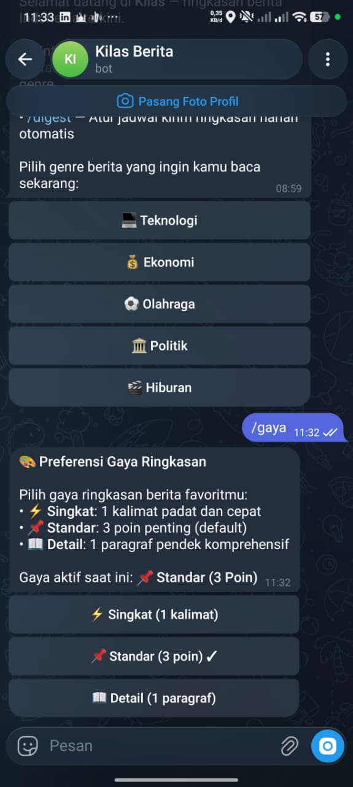
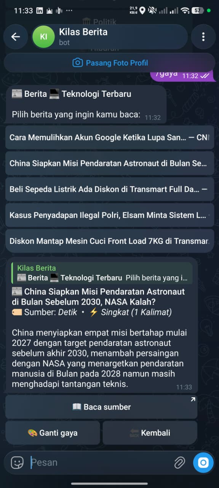

# 📰 Kilas

Bot Telegram yang merangkum berita Indonesia per genre. Pilih genre, pilih berita, dapat intinya dalam hitungan detik. ⚡

Sumber berita diambil lewat RSS (Antara, CNN Indonesia, Detik, Kompas), lalu diringkas LLM sesuai gaya pilihanmu.

## ✨ Fitur

| Fitur | Keterangan |
|---|---|
| 🗂️ 5 genre | Teknologi, Ekonomi, Olahraga, Politik, Hiburan |
| 📡 Multi sumber | Feed RSS diambil paralel dari 4 media nasional |
| 🎨 3 gaya ringkasan | Singkat (1 kalimat), Standar (3 poin, default), Detail (1 paragraf) |
| 🔄 Ganti gaya langsung | Tombol di bawah ringkasan, tanpa balik ke menu |
| ⏰ Digest harian | Top 5 berita tiap hari di jam pilihan (WIB) |
| 🤖 Multi provider LLM | Groq, Gemini, atau Claude |
| 💾 Cache SQLite | Artikel dan gaya yang sama tidak diringkas ulang |
| 🚦 Rate limiter | Maksimal 10 permintaan per menit per user |
| 🛡️ Tahan error | Feed rusak, artikel gagal diekstrak, atau user memblokir bot tidak membuat bot crash |

## 💬 Perintah Bot

| Perintah | Fungsi |
|---|---|
| `/start` | Mulai dan pilih genre berita |
| `/gaya` | Ubah gaya ringkasan |
| `/digest` | Atur atau matikan digest harian |

## 🚀 Mulai Cepat

### 1. 🔑 Siapkan token dan API key

**Token Telegram**
1. Buka [@BotFather](https://t.me/BotFather) lalu kirim `/newbot`.
2. Isi nama dan username bot (harus berakhiran `bot`).
3. Salin token yang diberikan.

**API key LLM (pilih salah satu)**

| Provider | Tempat ambil key | Catatan |
|---|---|---|
| Groq | [console.groq.com](https://console.groq.com/) | Gratis dan cepat, direkomendasikan |
| Gemini | [aistudio.google.com](https://aistudio.google.com/) | Ada free tier |
| Claude | [console.anthropic.com](https://console.anthropic.com/) | Berbayar |

### 2. 📦 Install

```bash
git clone https://github.com/username/Kilas.git
cd Kilas

python -m venv .venv

# Windows (PowerShell)
.\.venv\Scripts\Activate.ps1
# Linux / macOS
source .venv/bin/activate

pip install -r requirements.txt
```

### 3. ⚙️ Konfigurasi

```bash
cp .env.example .env      # Windows: copy .env.example .env
```

Buka `.env`, isi minimal `TELEGRAM_TOKEN` dan `LLM_API_KEY`.

### 4. ▶️ Jalankan

```bash
python -m kilas.bot.main
```

Buka bot kamu di Telegram lalu kirim `/start`.

## 🔧 Konfigurasi

Semua diatur lewat environment variable (file `.env`).

| Variabel | Wajib | Default | Keterangan |
|---|:---:|---|---|
| `TELEGRAM_TOKEN` | Ya | - | Token bot dari @BotFather |
| `LLM_API_KEY` | Ya | - | API key provider LLM |
| `LLM_PROVIDER` | Tidak | `groq` | `groq`, `gemini`, atau `claude` |
| `DATABASE_PATH` | Tidak | `kilas.db` | Lokasi file SQLite |
| `LOG_LEVEL` | Tidak | `INFO` | `DEBUG`, `INFO`, `WARNING`, `ERROR`, `CRITICAL` |
| `LLM_TIMEOUT` | Tidak | `30` | Batas waktu respons LLM (detik) |
| `GROQ_MODEL` | Tidak | `llama-3.1-8b-instant` | Otomatis fallback jika model 404 |
| `GEMINI_MODEL` | Tidak | `gemini-1.5-flash` | Model Gemini |
| `CLAUDE_MODEL` | Tidak | `claude-3-haiku-20240307` | Model Claude |

## 🏗️ Arsitektur

```text
Pengguna Telegram
       |
       v
   Bot Kilas (python-telegram-bot)
       |
       +--> RSS Aggregator (feedparser) --> Antara, CNN, Detik, Kompas
       |
       +--> Extractor (trafilatura) --> teks artikel
       |                                     |
       |                                     v
       |                              LLM Summarizer
       |                           (Groq / Gemini / Claude)
       |                                     |
       +--> SQLite (kilas.db) <--------------+
       |      user, langganan, cache
       |
       +--> APScheduler (Asia/Jakarta) --> digest harian
```

Struktur folder:

```text
Kilas/
├── kilas/
│   └── bot/
│       ├── main.py          # entry point
│       ├── handlers.py      # handler command dan tombol
│       ├── keyboards.py     # inline keyboard
│       ├── rss.py           # ambil dan gabung feed
│       ├── extractor.py     # ekstraksi teks artikel
│       ├── summarizer.py    # prompt dan provider LLM
│       ├── db.py            # SQLite
│       ├── scheduler.py     # digest harian
│       └── config.py        # load env
├── tests/
├── .env.example
├── requirements.txt
└── README.md
```

## 🧪 Testing

```bash
pytest -v
```

Cakupan test: RSS (parsing dan urutan), extractor (termasuk fallback), summarizer (prompt dan provider), database (preferensi, langganan, cache), rate limiter, dan scheduler. Semua test memakai mock, tidak ada akses network asli.

## ☁️ Deployment (opsional)

Bot memakai mode polling, jadi tidak butuh domain, SSL, atau webhook. Cukup jalankan sebagai worker yang aktif terus.

| Platform | Catatan |
|---|---|
| Railway | Mudah, tapi gratisnya berupa kredit bulanan |
| Render | Pilih **Background Worker**, web service gratis bisa tidur |
| VPS / Oracle Cloud Always Free | Paling fleksibel, setup manual |

Start command: `python -m kilas.bot.main`

Hal yang perlu diperhatikan:
- 💾 **SQLite butuh disk persisten.** Tanpa itu, cache, gaya, dan langganan digest hilang setiap redeploy. Di Railway, pasang Volume (mount `/data`) dan set `DATABASE_PATH=/data/kilas.db`.
- 1️⃣ **Jalankan satu instance saja.** Dua instance dengan token yang sama menyebabkan konflik polling (error 409).

## ⚠️ Batasan

1. Beberapa feed RSS kadang formatnya rusak. Kegagalan satu feed tidak mengganggu feed lain.
2. Bot didesain untuk satu instance karena SQLite berbasis file.
3. Model di provider gratis bisa dipensiunkan. Bot akan mencari model aktif secara otomatis jika terjadi error 404.
4. `callback_data` Telegram dibatasi 64 byte, jadi URL panjang dipetakan ke ID pendek.
5. Artikel berpaywall atau anti-scraping fallback ke deskripsi RSS.

## 📸 Demo

| Menu Genre & Berita | Hasil Ringkasan |
|:---:|:---:|
|  |  |

---

## ✅ Checklist Uji Manual End-to-End

Gunakan checklist ini untuk menguji seluruh alur dari aplikasi Telegram:

- [ ] **1. /start**: Bot membalas dengan sambutan dan 5 tombol genre (Teknologi, Bisnis/Ekonomi, Olahraga, Politik, Hiburan).
- [ ] **2. Pilih genre**: Menampilkan 5 berita terbaru lengkap dengan nama portal berita.
- [ ] **3. Pilih artikel**: Mengirim *"Sedang meringkas..."* lalu memperbarui pesan dengan judul, ringkasan 3 poin, sumber, serta tombol `[📖 Baca sumber]`, `[🎨 Ganti gaya]`, dan `[🔙 Kembali]`.
- [ ] **4. Ganti gaya interaktif**: Klik `[🎨 Ganti gaya]`, pilih Singkat/Detail, pesan artikel langsung diringkas ulang sesuai gaya baru.
- [ ] **5. Caching**: Klik ulang artikel yang sama dengan gaya yang sama, respon instan (Cache HIT) tanpa hit ke LLM.
- [ ] **6. Perintah /gaya**: Memilih preferensi gaya default user dan tersimpan ke database.
- [ ] **7. Perintah /digest**: Mengatur langganan genre dan jam harian (WIB), serta opsi matikan digest.
- [ ] **8. Rate limiting**: Coba klik ringkasan lebih dari 10 kali dalam 1 menit, bot menolak ramah hingga cooldown.
- [ ] **9. Navigasi & error handling**: Tombol kembali bekerja normal, error tidak membuat bot crash.
